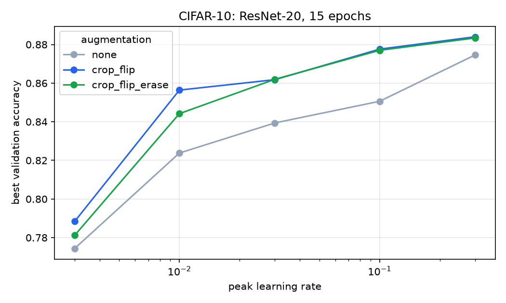
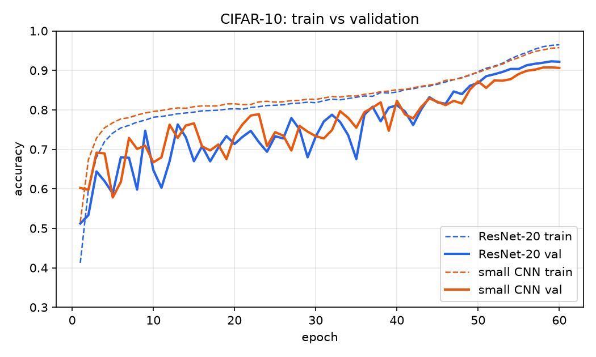
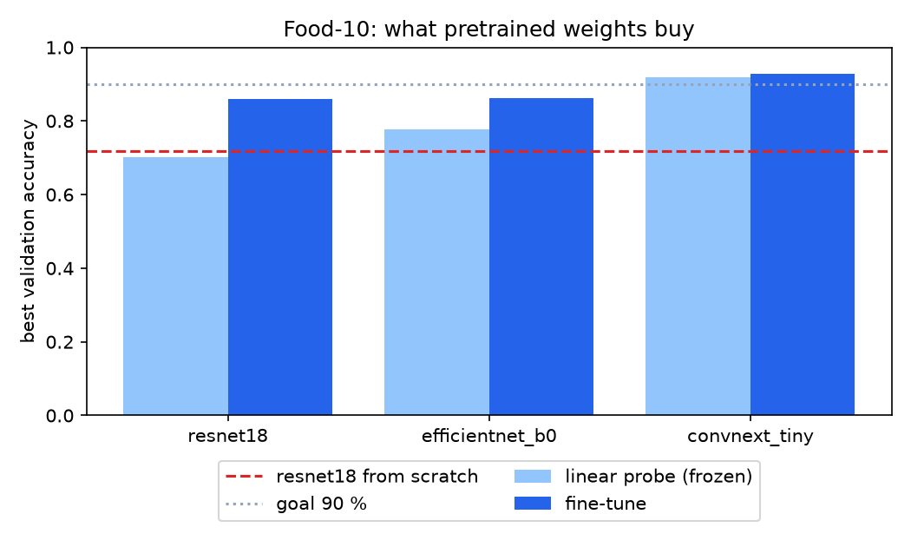
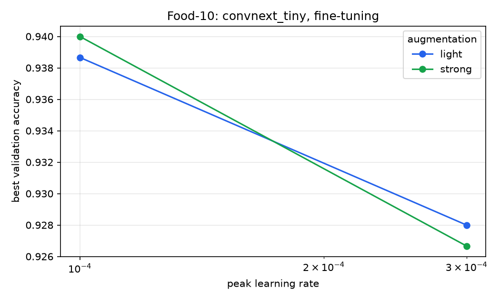
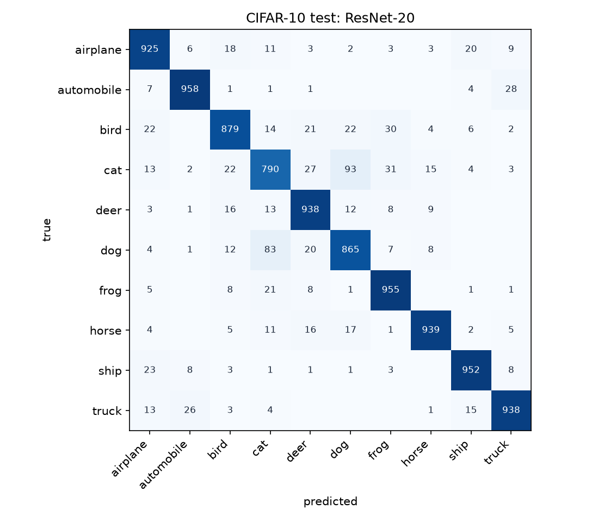
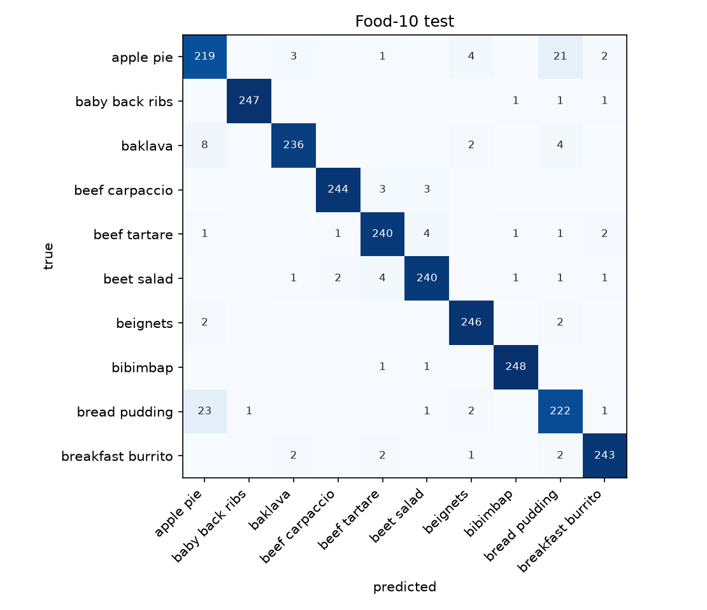
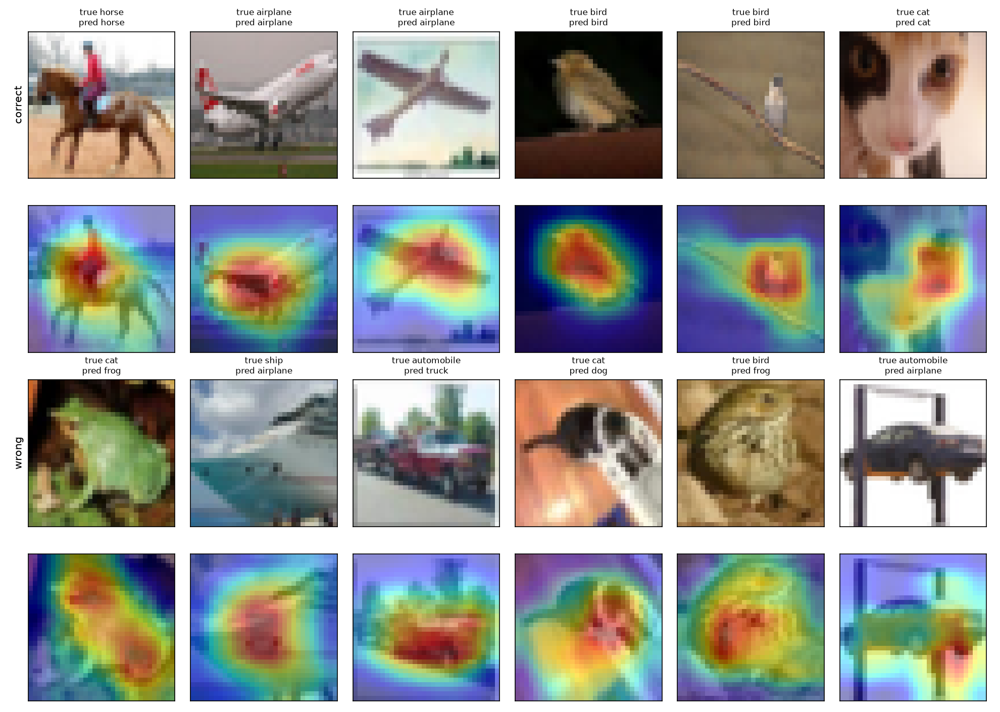
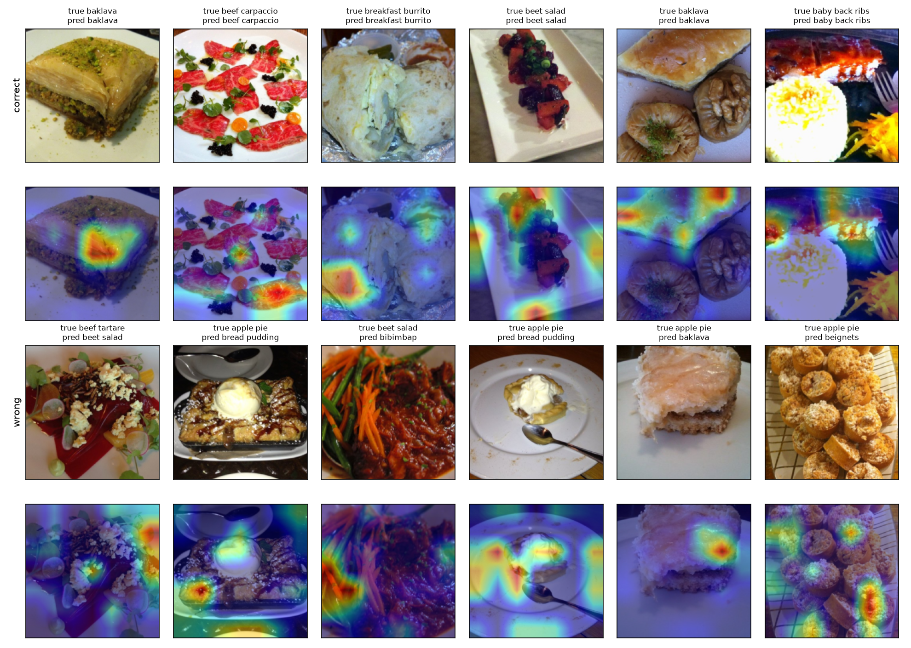

# 11 · Image classifier in PyTorch (P3)

🇸🇰 [Slovenská verzia](README.sk.md) · 📘 [Step-by-step tutorial](TUTORIAL.md)

## TL;DR
- **CIFAR-10:** ResNet-20 written by hand reaches **91.35 % ± 0.31** on test (3 seeds), goal was 80 %. Baselines: 10 % majority class, 40.04 % linear model.
- **Food-101, 10 classes:** a fine-tuned ConvNeXt-Tiny reaches **94.76 % ± 0.68** on test (3 seeds), goal was 90 %. The same data from scratch gives 75.08 %.
- **Augmentation vs learning rate:** across 15 runs the learning rate moved validation accuracy from 77.4 % to 88.4 %, augmentation by about 1 to 3 points. Random erasing added nothing on top of crop and flip.
- **Errors:** cat vs dog is 176 of 861 CIFAR errors. Apple pie vs bread pudding is 44 of 115 Food-10 errors.
- **ONNX:** same test accuracy (95.40 %), logits within 3e-5, 15 ms per image on CPU against 299 ms in PyTorch.

## Start here
The model receives a picture and must say **what it shows**: perhaps a cat, a car, or a kind of food. It sees many labelled examples, gradually adjusts its weights, and is then evaluated on pictures it did not see during training. **Accuracy** is the share of test pictures with the correct answer.

The project first tries a simple model that treats each pixel as a separate number. It then builds a convolutional network (CNN), which learns small image patterns, and a custom ResNet that can stack more layers. On CIFAR-10, ResNet-20 reaches 91.35% test accuracy versus 40.04% for the simple linear model. For ten kinds of food, the project reuses a network already trained on other images and adapts it to the new pictures; it reaches 94.76%.

Plots show training progress and confused classes, **Grad-CAM** highlights image regions associated with a prediction, and ONNX export shows how to use the model outside the training script. Test numbers describe these datasets, not an ability to recognize any picture.

## Problem
Train an image classifier with my own training loop on Apple Silicon, first from scratch, then with transfer learning, and track every experiment. The roadmap goals: ≥ 80 % on CIFAR-10 with my own CNN, ≥ 90 % top-1 on a 10-class Food-101 subset, ≥ 10 MLflow runs comparing learning rate and augmentation, a confusion matrix. Stretch goals: Grad-CAM and ONNX export.

## Setup
- **CIFAR-10:** 60,000 images of 32×32 px. Split 45,000 train / 5,000 validation / 10,000 test.
- **Food-10:** the first 10 Food-101 classes alphabetically, so nobody can say the easy dishes were picked. 6,750 train / 750 validation / 2,500 test.
- **Hardware:** Mac mini M4 Pro, 48 GB, PyTorch 2.15 on MPS. Latency was measured on the same machine's CPU.
- **Rules:** hyperparameters are chosen on validation. Test is touched only by baselines and final models. Final models use seeds 0, 1, 2. MPS is not bit-for-bit deterministic, so repeated runs differ slightly.
- **Tracking:** 37 finished MLflow runs in `mlflow.db` (24 CIFAR, 13 Food-10).

## How it works

### The training loop
`engine.py` uses PyTorch directly, without a higher-level training framework. One step is always the same five lines:

```python
logits = model(x)  # forward
loss = F.cross_entropy(logits, y)  # softmax + negative log-likelihood from step 08
optimizer.zero_grad(set_to_none=True)
loss.backward()  # autograd from step 04, at scale
optimizer.step()
```

`model.train()` and `model.eval()` matter more than they look. BatchNorm normalises with the statistics of the current batch while training and with running averages during evaluation. Forgetting `eval()` makes results depend on batch composition.

The learning rate follows a one-cycle schedule, updated every batch: a quick rise and a long fall. A high rate early moves the weights far, a low rate late settles them.

### From a matrix to a ResNet
`models_cnn.py` has three models. The linear model gives every pixel its own weight per class, so it knows nothing about neighbouring pixels. A convolution slides the same small filter over the image, so a feature learned in one corner works everywhere, with far fewer weights.

Stacking more layers eventually makes training worse, not better. A residual block fixes this by learning only a correction:

```python
out = F.relu(self.bn1(self.conv1(x)), inplace=True)
out = self.bn2(self.conv2(out))
return F.relu(out + self.shortcut(x), inplace=True)  # F(x) + x
```

If a block has nothing to add, it can push its weights towards zero and pass the input through. Gradients also get a direct path backwards. ResNet-20 has 272,474 weights.

### Transfer learning
A pretrained network has already learned edges, textures and shapes from ImageNet. `experiment_food.py` replaces its last layer and tries two levels of reuse:
- **Linear probe:** freeze everything, train the new head. The backbone stays in `eval()`, otherwise its BatchNorm statistics drift even with frozen weights.
- **Fine-tuning:** train everything, with the random head learning 10× faster than the pretrained body, which only needs nudging.

### Grad-CAM
`gradcam.py` asks where the model found its evidence. The gradient of the class score with respect to the last convolutional feature maps says how much each channel matters. Averaging it over the map gives one weight per channel, and the weighted sum of the channels is the heatmap. A ReLU keeps only regions that speak for the class.

## Results

### CIFAR-10

| Model | Weights | Test accuracy |
|---|---|---|
| Majority class (baseline) | 0 | 10.00 % |
| Linear on raw pixels, 15 epochs (baseline) | 30,730 | 40.04 % |
| Small CNN, 60 epochs, 3 seeds | 288,746 | 90.13 % ± 0.01 |
| **ResNet-20, 60 epochs, 3 seeds** | 272,474 | **91.35 % ± 0.31** |

One 60-epoch ResNet-20 run takes about 7.5 minutes on MPS.




The best configuration was a peak learning rate of 0.3 with crop and flip (88.40 % validation after 15 epochs). 0.3 is the top of the grid, so a higher rate might do even better. Random erasing scored 88.34 %, which is inside the noise. Without augmentation the best run reached 87.46 %.

### Food-10

| Model | Mode | Validation | Test |
|---|---|---|---|
| Majority class (baseline) | | | 10.00 % |
| ResNet-18 | from scratch, 30 epochs | 71.87 % | 75.08 % |
| ResNet-18 | linear probe | 70.27 % | |
| ResNet-18 | fine-tune | 85.87 % | |
| EfficientNet-B0 | linear probe | 77.60 % | |
| EfficientNet-B0 | fine-tune | 86.27 % | |
| ConvNeXt-Tiny | linear probe | 91.87 % | |
| ConvNeXt-Tiny | fine-tune, lr 3e-4 | 92.80 % | |
| **ConvNeXt-Tiny** | **fine-tune, lr 1e-4, strong augmentation, 3 seeds** | **94.00 %** (sweep) | **94.76 % ± 0.68**, top-3 99.5 % |




The linear probe on ConvNeXt, trained in 6 minutes, already beats 30 epochs from scratch by 20 points. ConvNeXt-Tiny was pretrained on ImageNet-22k, which may help more than its architecture, since the other two started from ImageNet-1k. In the 2 × 2 sweep the learning rate mattered (93.9 to 94.0 % at 1e-4, 92.7 to 92.8 % at 3e-4) and light vs strong augmentation did not.

### ONNX

| Runtime | Test accuracy | CPU, 1 image (median of 100) |
|---|---|---|
| PyTorch | 95.40 % | 299 ms |
| ONNX Runtime | 95.40 % | 15 ms |

This is the best seed by validation (seed 2). The largest logit difference is 2.8e-5 and the file has 111 MB. I measured the 20× gap twice and got the same answer, but it is one model on one machine.

## Error analysis



CIFAR-10 errors are not spread evenly. Cat has 79.0 % recall, dog 86.5 %, automobile 95.8 %. Cat ↔ dog is 176 of the 861 errors of the best model: at 32×32 px the two share pose, fur and background.



Food-10 has one big problem. Apple pie (87.6 %) and bread pudding (88.8 %) cause 44 of the 115 errors, and the other classes sit between 94.4 and 99.2 %. In the worst misses one dish really is on the other's plate, such as a pudding-like slice labelled apple pie. Food-101 training labels are known to be noisy while the test set was cleaned by hand, which fits test scoring above validation here.

ConvNeXt seeds differ by up to 1.4 points on test (94.04, 94.84, 95.40 %). The gap between 1e-4 and 3e-4 is about 1.2 points on validation with both augmentations, which is suggestive and no more. Light vs strong augmentation differs by 0.1, well inside the noise.

### Where the models look


On CIFAR-10 the maps cover the object, even for mistakes: the wrong answers are mostly the right region with the wrong conclusion.



On Food-10 they are much less clean. Only 22.6 % of the heatmap falls in the central quarter of the image, against 25 % for a uniform map, so the evidence is spread out and often touches the plate. Food fills the frame and is recognised by texture, so a single location may not exist. These maps are a hint and do not prove what the model understood.

## 🏎️ On the cars
Racing Lab [chapter 11](https://github.com/kavicka/05-racing-lab#ch-11--driving-from-pixels) removes the ray sensors. The car gets a 64×64 top-down picture and a CNN learns to drive from it. Over 3 seeds it finishes 38.0 of 50 unseen tracks on average, an MLP on the same pixels 34.7, and the teacher using rays 43. That CNN deliberately has no global average pooling: a classifier asks *whether* something is in the picture, a driver asks *where*.


## What I learned
- A learning rate search pays off first: it moved results by 11 points, augmentation by 1 to 3.
- A small CNN gets within 1.2 points of ResNet-20 at this depth. Residual connections matter more as networks grow.
- Pretrained weights beat architecture work on small data: 6 minutes of linear probe beat 15 minutes of training from scratch by 20 points.
- The backbone choice mattered more than fine-tuning it: ConvNeXt's frozen features beat the other two fine-tuned.
- One accuracy number hides the problem. The confusion matrix shows that one pair of classes causes 38 % of Food-10 errors.
- Long runs need to survive interruptions. Training once died with its session and lost an hour of work, so every run now saves as it finishes and the chain runs detached.

## Run it
```bash
uv sync
uv run python experiment_cifar.py   # baselines, 15-run sweep, final models → results.json
uv run python experiment_food.py    # downloads 5 GB, keeps 10 classes, about 4 hours on MPS
uv run python gradcam.py            # needs the saved models
uv run python export_onnx.py
uv run python plot.py               # → assets/*.png
uv run mlflow ui --backend-store-uri sqlite:///mlflow.db
```
`sh run_all.sh` runs everything in order.

## Limitations
- 10 Food-101 classes are not Food-101. These results say nothing about all 101 classes.
- The Food-10 sweep has only 4 runs because one ConvNeXt run takes 27 minutes on MPS. I cut it down from 9.
- The 88.4 % CIFAR sweep result sits at the top of the learning-rate grid, so the true optimum may lie higher.
- Three seeds give a rough spread, not a confidence interval.
- Test accuracy of the 15-epoch sweep runs was not measured, by design.
- Weights, datasets and `mlflow.db` are not in the repo, so the numbers come from `results.json` and can be regenerated with the commands above.
