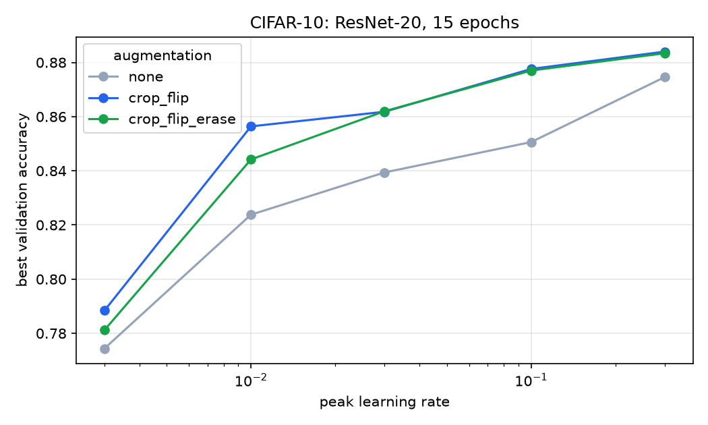
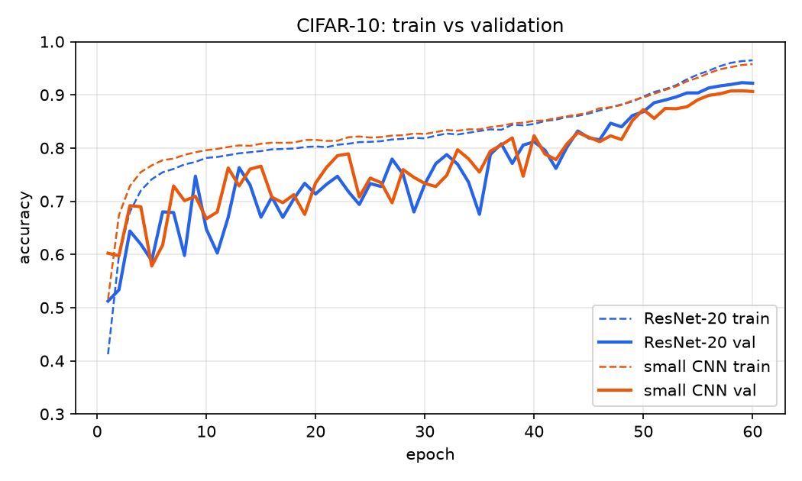
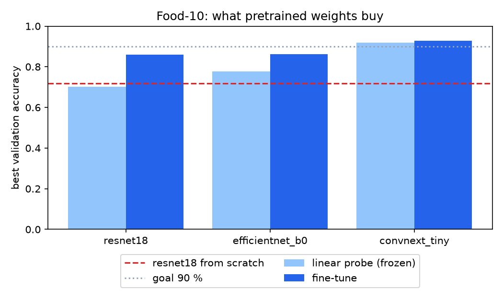
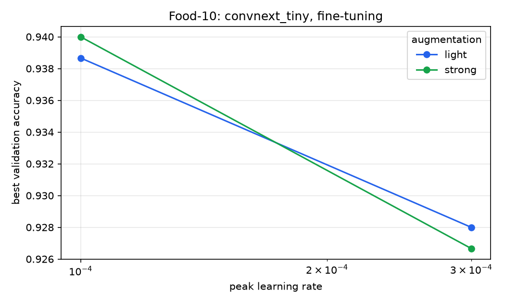
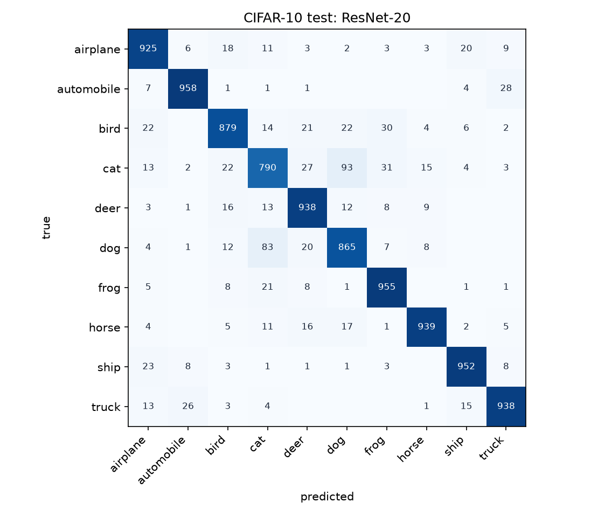
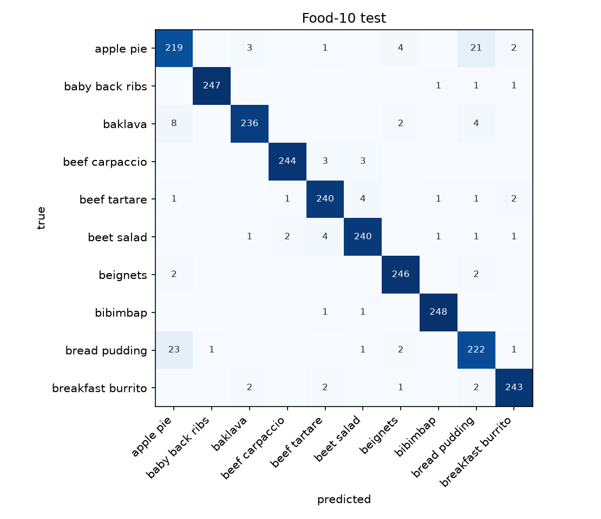
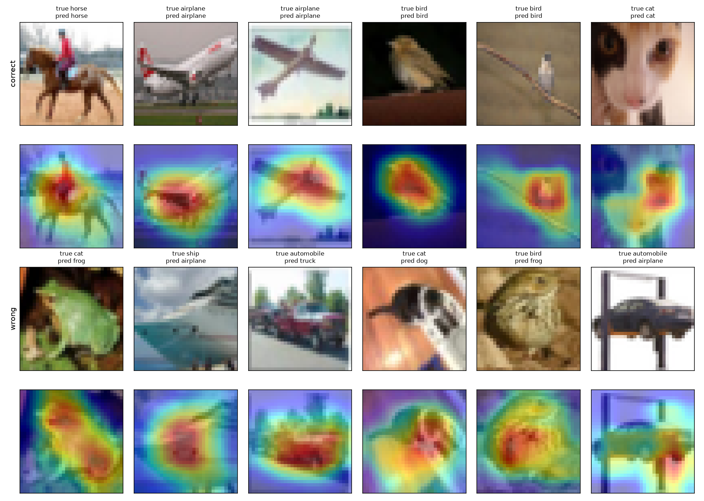
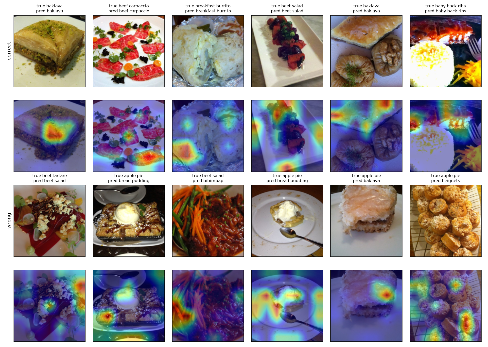

# 11 · Klasifikátor obrázkov v PyTorchi (P3)

🇬🇧 [English version](README.md)

## TL;DR
- **CIFAR-10:** ručne napísaný ResNet-20 dosiahne na teste **91,35 % ± 0,31** (3 seedy), cieľ bol 80 %. Baseline: 10 % najčastejšia trieda, 40,04 % lineárny model.
- **Food-101, 10 tried:** doladený ConvNeXt-Tiny dosiahne na teste **94,76 % ± 0,68** (3 seedy), cieľ bol 90 %. Tie isté dáta od nuly dajú 75,08 %.
- **Augmentácia vs learning rate:** v 15 behoch learning rate posunul validačnú presnosť zo 77,4 % na 88,4 %, augmentácia asi o 1 až 3 body. Random erasing k orezaniu a prevráteniu nič nepridal.
- **Chyby:** mačka vs pes je 176 z 861 chýb na CIFAR. Jablkový koláč vs chlebový puding je 44 zo 115 chýb na Food-10.
- **ONNX:** rovnaká testová presnosť (95,40 %), logity do 3e-5, 15 ms na obrázok na CPU oproti 299 ms v PyTorchi.

## Problém
Natrénovať klasifikátor obrázkov vlastným trénovacím cyklom na Apple Silicon, najprv od nuly, potom cez transfer learning, a každý experiment zaznamenať. Ciele z roadmapy: ≥ 80 % na CIFAR-10 s vlastnou CNN, ≥ 90 % top-1 na 10 triedach z Food-101, ≥ 10 behov v MLflow porovnávajúcich learning rate a augmentáciu, confusion matrix. Rozšírenia: Grad-CAM a export do ONNX.

## Setup
- **CIFAR-10:** 60 000 obrázkov 32×32 px. Rozdelenie 45 000 tréning / 5 000 validácia / 10 000 test.
- **Food-10:** prvých 10 tried z Food-101 podľa abecedy, takže nikto nemôže povedať, že som vybral ľahké jedlá. 6 750 tréning / 750 validácia / 2 500 test.
- **Hardvér:** Mac mini M4 Pro, 48 GB, PyTorch 2.15 na MPS. Latencia je meraná na CPU toho istého stroja.
- **Pravidlá:** hyperparametre sa vyberajú na validácii. Testu sa dotýkajú len baseline a finálne modely. Finálne modely používajú seedy 0, 1, 2. MPS nie je deterministické na bit presne, takže opakované behy sa mierne líšia.
- **Záznam:** 37 dokončených behov v MLflow v `mlflow.db` (24 CIFAR, 13 Food-10).

## Ako to funguje

### Trénovací cyklus
`engine.py` nepoužíva žiadny framework. Jeden krok je vždy týchto päť riadkov:

```python
logits = model(x)  # forward
loss = F.cross_entropy(logits, y)  # softmax + negative log-likelihood z kroku 08
optimizer.zero_grad(set_to_none=True)
loss.backward()  # autograd z kroku 04, vo veľkom
optimizer.step()
```

`model.train()` a `model.eval()` sú dôležitejšie, než vyzerajú. BatchNorm pri tréningu normalizuje štatistikami aktuálnej dávky a pri vyhodnotení kĺzavými priemermi. Keď sa zabudne na `eval()`, výsledky závisia od zloženia dávky.

Learning rate ide podľa one-cycle plánu a mení sa po každej dávke: rýchly nárast a dlhý pokles. Vysoká hodnota na začiatku posunie váhy ďaleko, nízka na konci ich usadí.

### Od matice k ResNetu
V `models_cnn.py` sú tri modely. Lineárny model dáva každému pixelu vlastnú váhu pre každú triedu, takže o susedných pixeloch nič nevie. Konvolúcia posúva ten istý malý filter po obrázku, takže príznak naučený v jednom rohu funguje všade, a to s oveľa menším počtom váh.

Pridávanie vrstiev v istom bode tréning zhorší, nie zlepší. Reziduálny blok to rieši tak, že sa učí len opravu:

```python
out = F.relu(self.bn1(self.conv1(x)), inplace=True)
out = self.bn2(self.conv2(out))
return F.relu(out + self.shortcut(x), inplace=True)  # F(x) + x
```

Keď blok nemá čo pridať, môže stlačiť váhy k nule a vstup len prepustiť. Gradienty majú navyše priamu cestu späť. ResNet-20 má 272 474 váh.

### Transfer learning
Predtrénovaná sieť sa už na ImageNete naučila hrany, textúry a tvary. `experiment_food.py` vymení jej poslednú vrstvu a skúša dve úrovne opätovného použitia:
- **Linear probe:** všetko zmrazíme a trénujeme novú hlavu. Backbone zostáva v `eval()`, inak by sa jeho štatistiky BatchNormu posúvali aj pri zmrazených váhach.
- **Fine-tuning:** trénujeme všetko, pričom náhodná hlava sa učí 10× rýchlejšie než predtrénované telo, ktoré treba len jemne doladiť.

### Grad-CAM
`gradcam.py` sa pýta, kde model našiel dôkazy. Gradient skóre triedy podľa posledných konvolučných máp príznakov hovorí, ako veľmi záleží na každom kanáli. Priemer cez mapu dá jednu váhu na kanál a vážený súčet kanálov je heatmapa. ReLU nechá len oblasti, ktoré hovoria v prospech triedy.

## Výsledky

### CIFAR-10

| Model | Váhy | Testová presnosť |
|---|---|---|
| Najčastejšia trieda (baseline) | 0 | 10,00 % |
| Lineárny na surových pixeloch, 15 epoch (baseline) | 30 730 | 40,04 % |
| Malá CNN, 60 epoch, 3 seedy | 288 746 | 90,13 % ± 0,01 |
| **ResNet-20, 60 epoch, 3 seedy** | 272 474 | **91,35 % ± 0,31** |

Jeden beh ResNet-20 so 60 epochami trvá na MPS asi 7,5 minúty.




Najlepšia konfigurácia bol vrcholový learning rate 0,3 s orezaním a prevrátením (88,40 % na validácii po 15 epochách). 0,3 je horný okraj mriežky, takže vyššia hodnota by mohla dopadnúť ešte lepšie. Random erasing dosiahol 88,34 %, čo je v šume. Bez augmentácie mal najlepší beh 87,46 %.

### Food-10

| Model | Režim | Validácia | Test |
|---|---|---|---|
| Najčastejšia trieda (baseline) | | | 10,00 % |
| ResNet-18 | od nuly, 30 epoch | 71,87 % | 75,08 % |
| ResNet-18 | linear probe | 70,27 % | |
| ResNet-18 | fine-tuning | 85,87 % | |
| EfficientNet-B0 | linear probe | 77,60 % | |
| EfficientNet-B0 | fine-tuning | 86,27 % | |
| ConvNeXt-Tiny | linear probe | 91,87 % | |
| ConvNeXt-Tiny | fine-tuning, lr 3e-4 | 92,80 % | |
| **ConvNeXt-Tiny** | **fine-tuning, lr 1e-4, silná augmentácia, 3 seedy** | **94,00 %** (sweep) | **94,76 % ± 0,68**, top-3 99,5 % |




Linear probe na ConvNeXte, natrénovaný za 6 minút, už porazí 30 epoch od nuly o 20 bodov. ConvNeXt-Tiny bol predtrénovaný na ImageNet-22k, čo mohlo pomôcť viac než samotná architektúra, keďže ostatné dva začínali z ImageNet-1k. V sweepe 2 × 2 záležalo na learning rate (93,9 až 94,0 % pri 1e-4, 92,7 až 92,8 % pri 3e-4), na ľahkej vs silnej augmentácii nie.

### ONNX

| Runtime | Testová presnosť | CPU, 1 obrázok (medián zo 100) |
|---|---|---|
| PyTorch | 95,40 % | 299 ms |
| ONNX Runtime | 95,40 % | 15 ms |

Ide o najlepší seed podľa validácie (seed 2). Najväčší rozdiel v logitoch je 2,8e-5 a súbor má 111 MB. 20-násobný rozdiel som zmeral dvakrát s rovnakým výsledkom, ale je to jeden model na jednom stroji.

## Analýza chýb



Chyby na CIFAR-10 nie sú rozložené rovnomerne. Mačka má recall 79,0 %, pes 86,5 %, auto 95,8 %. Mačka ↔ pes je 176 z 861 chýb najlepšieho modelu: pri 32×32 px majú obe triedy podobnú pózu, srsť aj pozadie.



Food-10 má jeden veľký problém. Jablkový koláč (87,6 %) a chlebový puding (88,8 %) spôsobujú 44 zo 115 chýb a ostatné triedy sú medzi 94,4 a 99,2 %. Pri najhorších omyloch je na tanieri naozaj niečo, čo vyzerá ako to druhé jedlo, napríklad kúsok podobný pudingu označený ako jablkový koláč. Tréningové značky Food-101 sú známe šumom, kým testovacia sada bola čistená ručne, čo sedí na to, že test tu vychádza vyššie než validácia.

Seedy ConvNeXtu sa na teste líšia až o 1,4 bodu (94,04, 94,84, 95,40 %). Rozdiel medzi 1e-4 a 3e-4 je na validácii asi 1,2 bodu pri oboch augmentáciách, čo je náznak a nič viac. Ľahká a silná augmentácia sa líšia o 0,1, čo je hlboko v šume.

### Kam sa modely pozerajú


Na CIFAR-10 mapy pokrývajú objekt, a to aj pri chybách: nesprávne odpovede sú väčšinou správna oblasť so zlým záverom.



Na Food-10 sú oveľa menej čisté. Do stredovej štvrtiny obrázka padá len 22,6 % heatmapy, pri rovnomernej mape by to bolo 25 %, takže dôkazy sú rozptýlené a často zasahujú aj tanier. Jedlo vypĺňa celý záber a rozpoznáva sa podľa textúry, takže jedno konkrétne miesto možno ani neexistuje. Tieto mapy sú nápoveda a nedokazujú, čo model pochopil.

## 🏎️ Na autíčkach
[Kapitola 11](https://github.com/kavicka/05-racing-lab/blob/main/README.sk.md#kap-11--jazda-z-pixelov) Racing Labu odstráni lúčové senzory. Auto dostane obrázok zhora s rozmerom 64×64 a CNN sa z neho naučí jazdiť. Cez 3 seedy dokončí v priemere 38,0 z 50 neznámych tratí, MLP na rovnakých pixeloch 34,7 a učiteľ s lúčmi 43. Táto CNN zámerne nemá global average pooling: klasifikátor sa pýta, *či* je niečo na obrázku, vodič sa pýta, *kde*.


## Čo som sa naučil
- Hľadanie learning rate sa vyplatí ako prvé: posunulo výsledky o 11 bodov, augmentácia o 1 až 3.
- Malá CNN sa pri tejto hĺbke dostane na 1,2 bodu od ResNet-20. Reziduálne spojenia sú dôležitejšie pri väčších sieťach.
- Predtrénované váhy na malých dátach porazia prácu na architektúre: 6 minút linear probe porazilo 15 minút tréningu od nuly o 20 bodov.
- Výber backbone znamenal viac než jeho doladenie: zmrazené príznaky ConvNeXtu porazili oba ostatné modely aj po fine-tuningu.
- Jedno číslo presnosti problém skryje. Confusion matrix ukáže, že jedna dvojica tried spôsobuje 38 % chýb na Food-10.
- Dlhé behy musia prežiť prerušenie. Tréning raz skončil spolu s reláciou a prišiel o hodinu práce, takže teraz sa každý beh ukladá po dokončení a reťaz beží odpojene.

## Spustenie
```bash
uv sync
uv run python experiment_cifar.py   # baseline, sweep s 15 behmi, finálne modely → results.json
uv run python experiment_food.py    # stiahne 5 GB, nechá 10 tried, asi 4 hodiny na MPS
uv run python gradcam.py            # potrebuje uložené modely
uv run python export_onnx.py
uv run python plot.py               # → assets/*.png
uv run mlflow ui --backend-store-uri sqlite:///mlflow.db
```
`sh run_all.sh` spustí všetko po poradí.

## Obmedzenia
- 10 tried z Food-101 nie je Food-101. Tieto výsledky nehovoria nič o všetkých 101 triedach.
- Sweep na Food-10 má len 4 behy, lebo jeden beh ConvNeXtu trvá na MPS 27 minút. Zmenšil som ho z 9.
- Výsledok 88,4 % zo sweepu na CIFAR je na hornom okraji mriežky learning rate, takže skutočné optimum môže byť vyššie.
- Tri seedy dávajú len hrubý rozptyl, nie interval spoľahlivosti.
- Testová presnosť 15-epochových behov zo sweepu sa zámerne nemerala.
- Váhy, datasety a `mlflow.db` nie sú v repe, takže čísla pochádzajú z `results.json` a dajú sa znova vygenerovať príkazmi vyššie.
